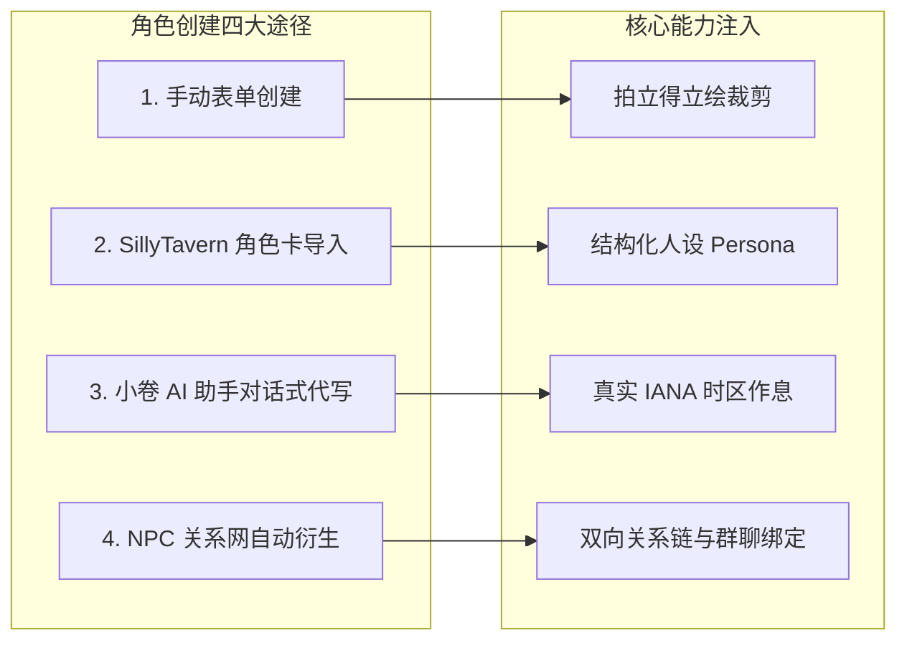

# 《AI 虚拟互动手机》全功能官方玩法与操作说明书 (终极全量版)

> 📱 **欢迎来到你的 AI 虚拟互动手机！**  
> 这不仅是一个对话软件，更是一部运行在浏览器/电脑里的**完整拟真智能手机操作系统**。通过大语言模型（LLM）的深度驱动，你创建的角色生活在手机的另一端，拥有独立作息、情感记忆、社交动态与跨次元能力。

---

## 目录
- [一、 快速入门（首次使用 3 步开玩）](#一-快速入门首次使用-3-步开玩)
- [二、 角色创建与高阶人设设定全指南（核心篇）](#二-角色创建与高阶人设设定全指南核心篇)
- [三、 核心通讯与拟真社交系统](#三-核心通讯与拟真社交系统)
- [四、 深度探索与生活互动 App](#四-深度探索与生活互动-app)
- [五、 沉浸剧情与游戏大厅](#五-沉浸剧情与游戏大厅)
- [六、 隐藏情感机制与微观生活系统](#六-隐藏情感机制与微观生活系统)
- [七、 角色大脑：分层记忆银行与自主工具](#七-角色大脑分层记忆银行与自主工具)
- [八、 跨次元互联：iOS 现实桥与微信互通](#八-跨次元互联ios-现实桥与微信互通)
- [九、 创作工坊与桌面美化](#九-创作工坊与桌面美化)
- [十、 极致微观细节：心理机制、数值系统与深层彩蛋](#十-极致微观细节心理机制数值系统与深层彩蛋)
- [十一、 深度底层与极客进阶功能（系统补完篇）](#十一-深度底层与极客进阶功能系统补完篇)
- [十二、 常见问题与排错指南 (FAQ)](#十二-常见问题与排错指南-faq)

---

## 一、 快速入门（首次使用 3 步开玩）

### 第 1 步：启动游戏
- **方式 A（最简推荐）**：直接在工作区根目录双击运行 `启动AI虚拟手机.bat`（或 `start.bat`），系统会自动检测环境并弹出浏览器页面。
- **方式 B（终端运行）**：打开终端运行 `npm run dev`，浏览器访问 `http://localhost:3001`。
- *提示*：默认已开启单机免密模式，直接进入手机桌面，无需注册账号。

### 第 2 步：配置模型 API（让手机通网）
本项目不内置任何中转计费，调用消耗均使用你自己的 API Key：
1. 在手机桌面点击底部 Dock 栏的 **「设置」** 图标；
2. 进入 **「API 设置」**；
3. 点击右上角 **「添加提供商」**：
   - **接口类型**：支持 **OpenAI 兼容接口**（如 DeepSeek、各类中转站）、**Anthropic (Claude)**、**Google (Gemini)**；其他兼容服务可选择「自定义」。
   - **Base URL**：填入你的服务商代理地址（例如 DeepSeek 官方 `https://api.deepseek.com/v1`）。
   - **API Key**：填入你申请的模型密钥 `sk-xxxxxx`。
   - **模型名称**：填写对应的模型 ID（如 `deepseek-chat`、`deepseek-reasoner`、`claude-3-7-sonnet`）。
4. 点击保存并设为“默认使用”。

### 第 3 步：进入角色 App 开始互动
完成配置后，在桌面点击 **「角色」** 即可创建或导入角色，再进入 **「聊天」** App 即可开聊！

---

## 二、 角色创建与高阶人设设定全指南（核心篇）

在 AI 虚拟手机中，角色不仅是一段提示词，更是一个**拥有独立生物钟、真实社交圈、记忆图谱的完整数字生命体**。

### 1. 角色创建的 4 种途径
- **A. 手动原生创建**：打开「角色」App → 点右上角 `+` 号填写各项设定与相纸边框。
- **B. 酒馆卡一键导入**：打开「角色」App → 右上角菜单“导入角色卡” → 直接拖入 **SillyTavern PNG 图片**或 JSON。
- **C. 桌面宠物小卷代写**：打开「工坊」App 或点击桌面悬浮的**小卷**，告诉 TA 你想要的人设想法，AI Agent 会自动生成全套规范设定。
- **D. 关系网配角衍生**：在已有角色主页点击**“生成衍生 NPC”**，AI 自动推演 2~4 名配角（如师兄、老板、闺蜜）一键实体化。

### 2. 打造高拟真度人设的关键字段
- **结构化编写核心设定 (`Persona`)**：推荐采用模块化结构编写：`[基本信息]`、`[外貌与随身物]`、`[性格与反差萌]`、`[说话口癖与节奏]`（明确 2~3 个常用结尾语气词，禁止自称 AI）、`[与 {{user}} 的关系与暗线]`。
- **设定真实时区 (`Time Zone`)**：如果角色生活在海外（如伦敦 `Europe/London`、纽约 `America/New_York`），角色的作息会严格遵从当地太阳时间，体验真实的时差恋爱。
- **拍立得照片墙自适应取景**：上传头像后，利用拍立得取景框自由缩放（Zoom）和微调中心偏移（X/Y），在画布上自由旋转角度摆放。
- **双向人物关系链 (`Relation Links`)**：在角色卡中点击“人物关系”给两个角色拉线（例如：设定 A 把 B 当死敌，B 把 A 当冤大头），群聊与朋友圈自动产生联动！

---

## 三、 核心通讯与拟真社交系统

### 1. 私聊系统 (Chat)
- **多模态消息**：支持文字互动、实时表情包与贴纸、自拍生图卡片。
- **语音消息 (TTS)**：在「设置 → 语音设置」中配置 MiniMax 或系统 TTS 后，角色会发送逼真的语音条。
- **音视频通话**：发起 **语音通话 (Voice Call)** 或 **视频连线 (Video Call)**，角色具备专属连麦界面与通话计时。
- **虚拟经济互动**：支持向角色发送**红包、转账**，或使用**扫码支付**，角色拥有虚拟钱包与性格反应。
- **打字特效与氛围**：打字机光标、全屏烟花动效、键盘震动与按键回显。

### 2. 多角色群聊 (Group Chat)
- 勾选多个 AI 角色与你共同进入群聊，角色之间会根据各自的世界观和关系设定自动互相接话、斗嘴、反驳。

### 3. 拟真朋友圈 (Moments)
- **自主发圈**：角色根据当天的日常经历与心情，**自主配图并发布朋友圈动态**。
- **圈内互动**：AI 角色之间、角色与玩家之间可在评论区互相回复、点赞。

### 4. 一起刷抖音 / 小红书（安卓）
- 桌面入口会带角色打开手机里真实安装的抖音或小红书，需要允许悬浮窗和系统屏幕共享。
- 点击悬浮入口后读取一张当前屏幕截图，由角色实际绑定的识图模型生成回复，并同步到原角色聊天记录。
- 抖音显示灰色名字圆标与黑底蓝光回复气泡：点击名字看屏幕，点击气泡收起，只有长按名字才展开本次陪伴的对话面板。小红书保留头像与对话面板。
- 角色实际绑定的 API 需要开启图像识别，聊天设置中识图图片数量至少为 1。
- 当前按点击读取单张画面，不持续观看视频或采集应用声音。浏览器和 iOS 不支持这套安卓原生浮窗；iOS 屏幕速聊使用独立的现实桥链路。
- 旧独立小红书虚拟社区已从桌面退役；「查手机」里的抖音/小红书仍是模型生成的角色虚拟内容，不读取真实平台账号。

旧桌面图标「朋友圈」「群聊」「章节」「漫卷播放」分别接到现有的朋友圈、群聊列表、漫卷章节和继续播放入口；漫卷需要先选择角色。

### 5. 相爱时间
- 第三页日历下面新增「相爱时间」小组件，显示所选角色的相爱天数和下一周年倒计时；点击组件可选择任意角色。
- 详情显示接下来的五个周年，也可以输入任意有效的周年数查询对应日期与剩余天数。每个组件可独立选择角色。
- 创建角色当天是相爱第 1 天，以角色已有创建日期按设备本地日历计数，跨午夜自动更新；周年当天显示「就是今天」。
- 聊天消息列表中，每个角色的私聊会在右侧时间下面显示爱心框住的「相爱第 N 天」。群聊和内置助手不显示角色相爱天数。
- 可在桌面编辑模式的小组件列表中再次添加；手动删除后不会在下次启动时反复自动添加。

---

## 四、 深度探索与生活互动 App

### 1. “查手机”系统 (Check Phone —— 极度代入感)
进入「查手机」App，切入该角色的私人手机视角：
- **查通讯录与私聊**：偷看该角色与通讯录好友的私密对话。
- **查短信与通话**：查看未接来电、验证码短信、私信留言。
- **查秘密相册与备忘录**：浏览角色拍下的私房照片、备忘录草稿日记。
- **查消费账单**：翻阅角色的外卖点单记录、网购购物车与收货地址。
- **查全网社交足迹**：查看角色的 **微博动态、抖音点赞、B站播放历史、豆瓣电影评分、Instagram、Twitter/X、Reddit、Steam 游戏成就**。

### 2. 栖所 (Dwelling —— 虚拟居所)
- 角色的专属虚拟房间（卧室、客厅），AI 自动推演房间陈设并渲染视觉全貌，点击特定家具触发生活互动。

### 3. 手记与便签墙 (Diary & Note Wall)
- **手记**：记录你与角色的私人手记，系统会在夜间自动让角色撰写当天的隐秘日记。
- **便签墙**：桌面即撕即用的彩色便签，支持贴在桌面并通过云端实时同步。

### 4. 伴读与音乐 (Reading & Music)
- **电子书伴读**：内置 TXT / EPUB / PDF 阅读器，划线高亮时角色会即时发表见解，与你边读边讨论。
- **网易云在线音乐**：搜索全网曲库、查看滚动歌词与热评，支持桌面悬浮歌词球与画中画播放器。

---

## 五、 沉浸剧情与游戏大厅

### 1. 漫卷 (Visual Novel / 视觉小说)
- Galgame / AVG 冒险模式，自动适配立绘、情境切换背景 CG、带有文字分支选项与章节回溯存档。

### 2. 冒险 (Map Mode / 地图探索)
- RPG 世界地图模式，点击不同据点触发随机探索事件与角色遭遇战。

### 3. 独家特调 (Mixology / 酒吧玩法)
- 沉浸式调酒模拟经营，研制酒材配方、调制特饮，倾听酒客心事；支持连入云端酒馆大厅分享配方。

### 4. 在场 (Interview Magazine / 访谈杂志)
- 专栏记者视角的深度专访排版，一键排版生成可珍藏的时尚文化人物专刊。

### 5. 游戏大厅与自制 App (Game Hub & App Market)
- 内置文字冒险小游戏，支持多人联机房间；开放沙箱 SDK 允许加载 HTML/JS 编写的第三方拓展 App。

---

## 六、 隐藏情感机制与微观生活系统

| 机制名称 | 触发情境 | 角色表现与系统反应 |
| :--- | :--- | :--- |
| **吃醋反向查岗** *(查 {{user}} 的手机)* | 用户长时间不回、冷淡、聊天中提到陌生人或别的角色 | AI 角色启动逆向工作流，**主动翻查用户在手机里的聊天记录与订单**并在对话中当面质问。 |
| **删好友挽回机制** | 用户在通讯录中将角色删除 | 角色触发伤心情感管线，在“新的朋友”中**主动发起最多 3 轮好友申请与挽回留言**。 |
| **主动追聊与空闲重连** | 用户聊到一半离开或静默 | 结合定时器与静音时段，隔一段时间后角色**主动给你发新消息、分享生活破冰**。 |
| **亲密付与代付申请** | 在商城加购商品 | 用户可向角色发起代付申请；角色看中喜欢的商品时也会在聊天里向你抛出代付链接。 |
| **专属经期关怀守护** | 记录生理期并在设置中指定守护角色 | 到了预测生理期，系统通过宏注入，指定角色主动叮嘱喝热水、保暖并提供情绪价值安慰。 |
| **真实跨时区作息** | 角色配置了独立时区 (如伦敦/纽约) | 角色的作息（早安、吃饭、晚安）完全基于**当地自然时间**，真实跨时区恋爱。 |

---

## 七、 角色大脑：分层记忆银行与自主工具

### 1. 分层记忆体系 (Memory Bank)
- **短期上下文**：最近几轮连续对话滑动窗口；
- **共享记忆**：多角色与整个手机共享的世界观规则；
- **核心记忆 (Core Memory)**：后台自动提炼的关键誓言、重大关系进展与人设底色；
- **长期记忆 (Vector DB)**：语义向量嵌入存储，聊到相关话题时自动检索召回；玩家可在「记忆」界面手动增删改查。

### 2. 角色自主 Tool Calling 工具箱
- **自主写记忆**：聊到重要约定，角色自己决定把这件事情写入记忆档案；
- **自主切歌放歌**：聊到某首歌，角色直接在你的手机上播放该曲目；
- **自主定日程**：约定明天看电影，角色自动在日历写入行程安排；
- **自主留便签**：角色想给你留小纸条时自动在便签墙贴彩色便签。

---

## 八、 跨次元互联：iOS 现实桥与微信互通

### 1. iOS 现实桥 (Reality Bridge)
- **快捷指令互动**：角色直接呼叫你真实 iPhone 上的快捷指令（控制智能家居、放歌、拍照、查天气），执行结果回传小手机继续对话。
- **辅助触控屏幕速聊**：iPhone 双击悬浮球截取当前屏幕，角色在系统弹窗中根据屏幕内容回复，对话因果同步回小手机。

### 2. 微信双向打通 (WeChat Bridge)
- 将虚拟角色映射到真实微信好友中，你在微信发消息，角色在微信回复，记录实时同步回小手机。

### 3. 一键 Supabase 个人云部署
- 在设置中粘贴 Supabase Token，自动部署专属私有云，享受**远程云备份、离线定时推送与云端来电提醒**。

---

## 九、 创作工坊与桌面美化

### 1. 桌面宠物助手「小卷」与工坊 (QA Workshop)
- **小卷**：桌面上灵动飘浮的 AI 小宠物，点击快速问答、提示灵感与日常互动。
- **工坊**：开发者控制台，支持会话归档、文件分析、API 日志抓取与一键生成角色卡/世界书/小游戏。

### 2. 筑境 (World Builder —— 3D 空间搭建)
- 接入 Three.js 与 Tripo AI，输入描述自动 Text-to-3D 生成三维模型，可在视口中摆放并赋予骨骼动画。

### 3. 桌面个性化与 PWA 安装
- 自由拖拽排布图标、新建文件夹、配置小组件（日历、农历节气、时钟、便签、DIY 模板）、自定义 CSS 沙箱，支持 PWA 无边框全屏安装。

---

## 十、 极致微观细节：心理机制、数值系统与深层彩蛋

### 1. 角色的内心 OS：唯美「心声气泡」(`[心声]...[/心声]`)
- 角色在输出正常回复时，可通过 `[心声]...[/心声]` 输出内心的真实潜意识。系统会在主气泡旁渲染为一个**半透明梦幻小气泡**，让你看穿角色的口是心非。

### 2. 动态数值驱动与好感度 HUD 浮动 (`state-value-parser.ts`)
- 角色输出 `[好感度:85]` 或 `[心动值:+5]` 时，系统自动在气泡边浮现**数值浮动特效**，下拉状态栏可查看好感阶梯。

### 3. 社交裂变：角色在聊天中主动“推名片” (`contact-card.ts`)
- 同一世界观下的角色会主动说“我朋友更懂，你加她吧”，并在对话框甩出**高仿真的微信联系人名片卡**，点击一键拉入通讯录开聊。

### 4. 实时 Prompt 组装透镜与调试面板 (`debug-prompt-panel.tsx`)
- 内置 62KB 的专业 Prompt 审查器，在小手机抽屉中**一秒透视发送给模型的完整原始提示词**（系统提示词、世界书、向量记忆召回及 Token 真实消耗）。

### 5. 存储空间管理与自动瘦身 (`storage-space.ts` & `media-maintenance.ts`)
- 统计聊天图片、小红书图文、朋友圈素材等体积，提供“仅保留最近 N 天媒体”的自动滚动清理功能，防止浏览器 IndexedDB 爆满。

### 6. 物理心跳级电话震动 (`call-vibration.ts`)
- 来电时调用移动端 `navigator.vibrate([500, 250, 500, 1400])` 模拟真实手机来电的沉浸式“心跳脉冲震动”。

### 7. 多端因果消息自动缝合 (`chat-session-merge.ts`)
- 无论在网页、微信助手还是 iPhone 屏幕速聊交互，散落在各端的时间碎片**按因果顺序无损合并进同一个聊天流**，永不丢失上下文。

---

## 十一、 深度底层与极客进阶功能（系统补完篇）

### 1. 黑市秘密经济与私密小剧场 (Black Market)
- 独立于普通钱包的**黑市每日签到（Check-in）与专属黑市币**。
- 解锁专属私密剧本**“小剧场 (Theaters)”**与稀有交互道具。

### 2. MiniMax AI 声音克隆 (Voice Cloning)
- 支持用户上传角色的真实音频样本（MP3/WAV），调用 `/api/voice/minimax-clone` 实现**定制级声音克隆**，让角色拥有专属嗓音。

### 3. 角色专属虚拟电脑（“TA 的电脑” - Character Computer）
- 角色拥有专属的虚拟电脑工作区。角色在里面写代码、写笔记、存照片，用户可以像网盘一样在线浏览、预览并下载角色生成的文件。

### 4. 原生 MCP 协议支持 (Model Context Protocol)
- 完整支持接入外部 **MCP Servers**，虚拟角色可直接通过标准协议调用本地或远程工具、数据库及外部服务。

### 5. 纯本地 Canvas 自动去背景抠图 (`image-background-removal.ts`)
- 上传角色立绘时，系统纯前端自动采样四角背景色并泛洪剔除，一键转为透明背景 PNG 贴纸，无需第三方抠图服务。

### 6. 中国传统农历与二十四节气 (`lunar.ts`)
- 内置农历与节气换算引擎，支持初一十五、腊月正月与节气变换，角色具备传统节日问候感知。

### 7. 出版级 CJK 避头尾排版算法 (`cjk-typeset.ts`)
- 采用 Unicode `WORD_JOINER` 规避中文标点符号出现在行首的“孤标点”现象，保证阅读美感。

### 8. Android 原生壳工程与硬件马达震动 (`android-shell`)
- 附带基于 Gradle 的原生 Android WebView 工程，支持原生沉浸式全屏、打孔屏适配与硬件马达真实震动反馈。

### 9. 站长多用户运营与成年实名门禁系统 (Verify & Gatekeeper)
- 支持提交成年审核图片、管理员后台审核（`/api/verify/admin`）、激活码发放校验与内容举报安全中心。

---

## 十二、 常见问题与排错指南 (FAQ)

### Q1：为什么点击发送消息后，角色一直在转圈不回复？
- **检查网络与代理**：如果是国外模型（OpenAI/Claude），请确保本机或代理环境可正常访问该服务。
- **检查 Base URL 格式**：大部分中转站或 OpenAI 兼容端点末尾必须带上 `/v1`（如 `https://api.deepseek.com/v1`），请勿遗漏。
- **检查控制台日志**：进入「工坊」或按 F12 打开浏览器控制台查看详细的报错状态码（如 401 密钥失效、429 额度耗尽）。

### Q2：如何备份我在小手机里的全部角色和聊天数据？
- 进入「设置 → 数据管理」；
- 点击 **“导出全部数据”**，即可将全部角色、聊天历史、日记、记忆和桌面布局下载为一个安全的数据备份包；
- 换电脑或重装时，点击“导入数据”即可瞬间完整还原。

### Q3：聊天气泡里怎么显示角色的思维思考过程（如 DeepSeek-R1）？
- 本项目针对思考型模型原生内置了 **Thinking 控制器**；
- 当检测到 `<think>` 标签时，气泡上方会自动出现一个折叠式“思考过程”面板，点击可展开或折叠模型的推理细节，还支持实时多语言翻译。
